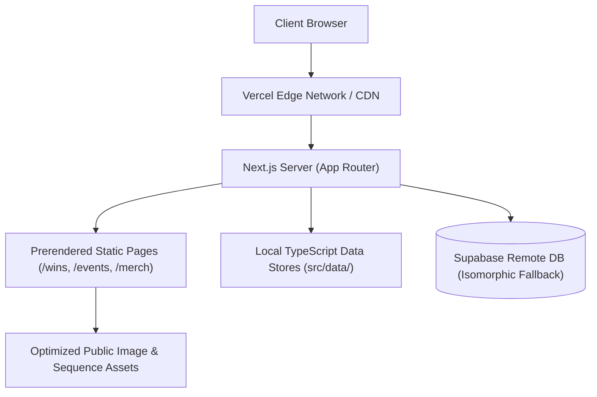
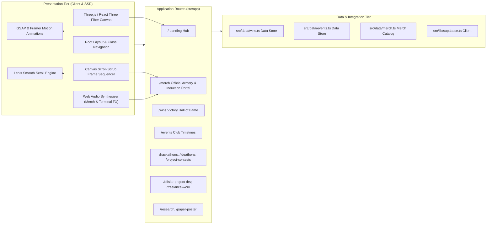

# Invictus Club Platform

<p align="center">
  
  
  
  
  
  
</p>

---

## Executive Summary

**Invictus Club Platform** is the flagship web application and community hub for **Invictus Club**, an elite developer committee, research guild, and engineering collective. Engineered with Next.js 16 (App Router + Turbopack), React 19, TypeScript, and Tailwind CSS v4, the platform showcases national hackathon victories, upcoming events, research publications, freelance engineering initiatives, member portfolios, and the official club armory & induction portal.

> [!NOTE]
> Tailored and optimized for deployment on Vercel with zero-configuration build targets, automated static site generation (SSG), and responsive edge delivery.

---

## High-Level Architecture (HLA)

The system follows a modern Jamstack pattern leveraging Next.js App Router, edge caching, static site generation (SSG), client-side interactivity, and Supabase Backend-as-a-Service with resilient local fallbacks.



---

## Low-Level Architecture (LLA)



---

## Key Features & Platform Modules

| Route | Description | Technical Highlights |
| :--- | :--- | :--- |
| `/` | Main Club Portal | Three.js interactive 3D mesh canvas, GSAP timeline animations, responsive achievement metrics |
| `/merch` | Official Armory & Induction Portal | 342-frame canvas scroll sequence scrub, reactive audio FX synthesizer, cart drawer & WhatsApp order generator |
| `/wins` | Hall of Fame | Categorized grid displaying national trophies, certificates, prize details, and lightbox preview modals |
| `/events` | Club Timeline | Categorized event cards (Upcoming, Ongoing, Past) with interactive schedule breakdowns |
| `/hackathons` | National Competitions | Architectural challenge stories, offline-fallback protocols, alumni code audit workflows |
| `/ideathons` | Innovation Pitches | Problem statement auditing, transactional sustainability modeling, and pitch benchmarks |
| `/project-contests` | Coding Challenges | Architectural bottleneck profiling, distributed worker clusters, and telemetry pipelines |
| `/offsite-project-dev` | Client Development | Real-world client software projects engineered by club members with production SLAs |
| `/freelance-work` | Developer Intake | Client inquiry form, high-velocity engineering sprint blueprints, and freelance service catalog |
| `/paper-poster` | Academic Publications | Conference paper catalog, citation links, and abstract reader modals |
| `/research` | Club Research | Empirical hypothesis testing, model quantization, edge wireless networking cohorts |

---

## Project Directory Structure

```
invictus-club/
|-- src/
|   |-- app/
|   |   |-- layout.tsx
|   |   |-- page.tsx
|   |   |-- globals.css
|   |   |-- sitemap.ts
|   |   |-- robots.ts
|   |   |-- events/page.tsx
|   |   |-- freelance-work/page.tsx
|   |   |-- hackathons/page.tsx
|   |   |-- ideathons/page.tsx
|   |   |-- merch/
|   |   |   |-- page.tsx
|   |   |   `-- MerchPortalClient.tsx
|   |   |-- offsite-project-dev/page.tsx
|   |   |-- paper-poster/page.tsx
|   |   |-- project-contests/page.tsx
|   |   |-- research/page.tsx
|   |   `-- wins/
|   |       |-- page.tsx
|   |       `-- WinsClient.tsx
|   |-- components/
|   |   |-- Navbar.tsx
|   |   |-- Footer.tsx
|   |   |-- merch/
|   |   |   |-- ScrollSequenceCanvas.tsx
|   |   |   |-- ScrollStageItem.tsx
|   |   |   |-- SimpleCheckoutTerminal.tsx
|   |   |   `-- MerchCartDrawer.tsx
|   |   |-- opportunities/
|   |   |   |-- OpportunityDetailHero.tsx
|   |   |   |-- OpportunitySection.tsx
|   |   |   `-- OpportunityFooterNav.tsx
|   |   `-- home/
|   |       `-- OpportunitiesSection.tsx
|   |-- data/
|   |   |-- events.ts
|   |   |-- merch.ts
|   |   `-- wins.ts
|   `-- lib/
|       |-- merch-audio.ts
|       |-- supabase.ts
|       |-- utils.ts
|       `-- wins-service.ts
|-- public/
|   |-- culture-pics/
|   |-- merch/
|   |   `-- sequence/all/
|   |-- photos/
|   |-- team/
|   |-- robots.txt
|   `-- sitemap.xml
|-- .env.example
|-- package.json
|-- tsconfig.json
|-- next.config.ts
`-- README.md
```

---

## Local Development Setup

> [!IMPORTANT]
> Ensure Node.js 18+ and npm are installed on your machine before running the setup commands.

### 1. Clone & Install Dependencies

```bash
git clone https://github.com/yashkoparde/invictus.git
cd invictus
npm install
```

### 2. Configure Environment Variables

Copy `.env.example` to `.env.local`:

```bash
cp .env.example .env.local
```

```env
NEXT_PUBLIC_SUPABASE_URL=your_supabase_project_url
NEXT_PUBLIC_SUPABASE_ANON_KEY=your_supabase_anon_key
```

### 3. Run Development Server

```bash
npm run dev
```

Open `http://localhost:3000` in your web browser.

---

## Production Build & Vercel Deployment

To test a production build locally:

```bash
npm run build
npm run start
```

### Deploying to Vercel

1. Push changes to GitHub repository: [yashkoparde/invictus](https://github.com/yashkoparde/invictus).
2. Import the repository in [Vercel Dashboard](https://vercel.com).
3. Set the Framework Preset to **Next.js**.
4. Configure optional environment variables (`NEXT_PUBLIC_SUPABASE_URL`, `NEXT_PUBLIC_SUPABASE_ANON_KEY`).
5. Click **Deploy**.

---

## Technology Stack

- **Framework**: Next.js 16 (Turbopack, App Router)
- **Language**: TypeScript 5
- **UI & Components**: React 19, Lucide React Icons
- **Styling**: Tailwind CSS v4, PostCSS
- **Animations**: GSAP (ScrollTrigger), Framer Motion, Anime.js, Lenis Smooth Scroll
- **3D Graphics & Canvas**: Three.js, React Three Fiber, 60fps Canvas Sequencer
- **Audio Synthesis**: Web Audio API (zero external sound files)
- **Backend & Auth**: Supabase JavaScript SDK
- **Deployment Platform**: Vercel Edge Network
